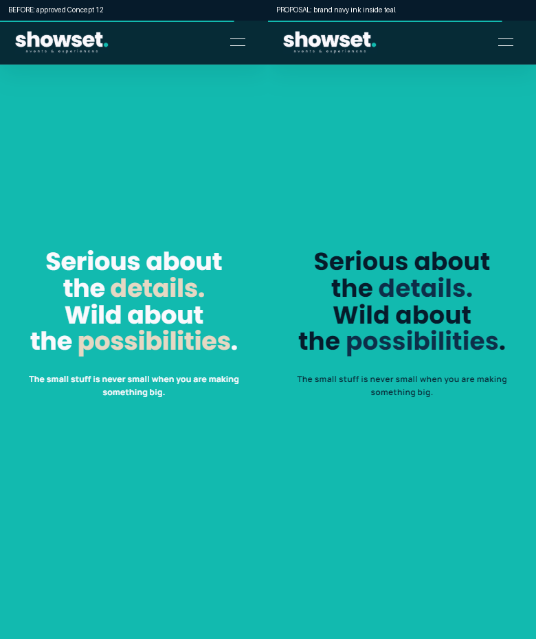
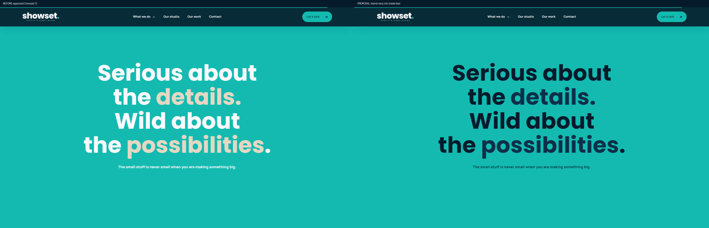
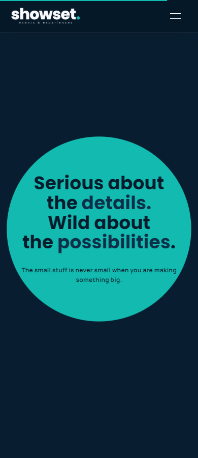

# Issue 4: contrast proposal — approval required before merge

The approved expanding dot uses ivory/sand lettering over teal. The measured ratios are 2.31:1 and 1.72:1. This proposal keeps the exact brand palette, typography, layout, sharp centred circle and original expansion/translation equations. Inside the teal circle only, the lettering uses deep navy (7.23:1) and navy emphasis (5.70:1). Outside the circle it keeps its approved light colours.

A single inert, aria-hidden text-only ink layer shares the original circle radius. An inverse mask removes light ink under the dark layer to avoid antialiasing fringes. It adds no image clones or layout measurements to the scroll frame. Source text remains the accessible text, and Studio changes update the ink layer from the same escaped content. Motion-off/no-JavaScript output uses the fully expanded mask.

Footer-bottom text increases from 45% white to 65% brand ivory over #041927: 7.68:1 after compositing. This is deliberately isolated from keyboard/reduced-motion work in PR 11.

## Visual review

Before is the approved refined Concept 12 captured from the running Next.js app; proposal is the actual new production build. These are review images, not a claim of pixel equality for animated frames.

## Validation and limits

- Production build, TypeScript, source/SEO checks and 50 functional, 22 refinement, nine global-editing and 16 lifecycle assertions pass.
- `qa/concept12-contrast.cjs`: 55 assertions cover forward/reverse ink/circle alignment at five widths, one inert layer, actual brand colour ratios and the composited footer colour.
- Axe reports no WCAG A/AA violations in the executed initial-view scans of all 12 routes and expanded-dot/footer scans at 390/1440. A 121-frame headless Chrome scroll sample recorded no long tasks or broken loaded images; it is not a device performance benchmark. This is a bounded automated scan, not full WCAG certification or physical-device evidence.
- Colour approval remains pending. Real iPhone Safari/Android Chrome mask rendering and recordings remain outstanding because no device session is available. Hosted CI remains blocked before runner startup by GitHub account billing/spending restrictions.

Do not merge this visual proposal without owner approval. No merge, hosting, deployment, CMS or production-mail change was performed.
