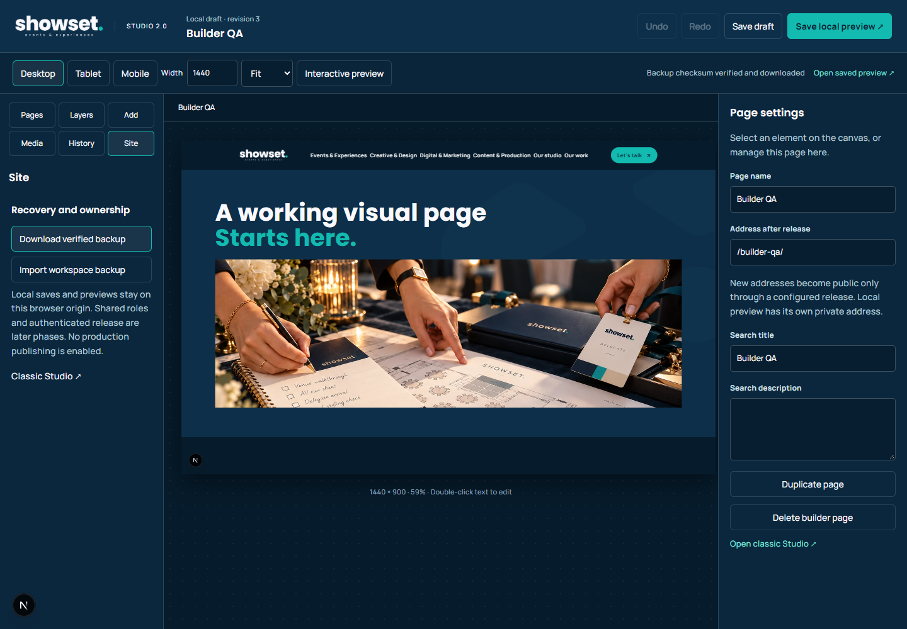

# Studio 2.0 — Phase 1 working slice

Part of issue #57. **This is the first local product milestone, not completion of the whole issue.** Branch `feat/studio-2-foundation` is based on approved main `3ea5f7d` (29 October 2026). Nothing is merged or deployed.

## Review the real experience

Run `npm run dev -- -p 3001`, then open <http://localhost:3001/studio/next/>. The first screen exports and verifies the original recovery records before creating a separate v2 draft. Classic Studio remains at `/studio/`. Production builds render an unavailable screen for both new Studio routes; there is no remote admin or release endpoint in this milestone.

[Editing walkthrough](studio-builder/evidence/phase1/walkthrough.webm) · [Builder forward/reverse motion](studio-builder/evidence/phase1/motion-forward-reverse.webm) · [Touch editing](studio-builder/evidence/phase1/touch-editing-390.png) · [Public desktop scroll](studio-builder/evidence/phase1/public-desktop-forward-reverse.webm) · [Public mobile scroll](studio-builder/evidence/phase1/public-mobile-forward-reverse.webm)

## Working capabilities

- Branded Poppins/Manrope workspace, real wordmark/pattern, searchable pages/layers/library/media/history, contextual inspectors and explicit small-screen Layers/Canvas/Inspector panels.
- Actual shared Concept 12 renderer for existing pages. Seven registered homepage-opening targets support selection, plain-text inline editing, content, typography, independent accent colour, design/responsive overrides and image replacement. The cinematic engine stays intact.
- A versioned nested page tree: section, container, heading/accent, text, image, link button, divider, spacer, native accordion, gallery and actual video. Create, name, route, duplicate and delete local builder pages. Drag/drop, reorder, copy/paste, duplicate, hide/lock/delete nodes; semantic text/media output is escaped.
- Responsive design controls, inherited computed values, reset, exact approved closing-pattern preset, original image upload/library, fit and independent mobile crop. Headers/footers on builder pages use the approved source; they are not a second visual approximation.
- Six generic motion choices including None, reversible scroll progress, viewport/load timing, appropriate contextual parameters and live OS reduced-motion fallback. No idle animation loop. Fade composes with authored opacity.
- Separate IndexedDB drafts, original media blobs, immutable revisions, undo/redo, autosave/manual save, failure/conflict state, verified portable snapshot import/export and real saved local preview. Atomic expected-revision checks prevent stale tabs overwriting a newer draft.
- Original legacy storage keys are never written by Studio 2.0. Pure adoption fills missing fields while preserving authored values, empty arrays and unknown extensions. Malformed data exposes raw recovery export instead of resetting to defaults.
- Preview form submissions are suppressed independently of motion. Classic Studio's explicit heading-size/body-size/spacing overrides are restored where newer default CSS had overridden them; unedited seed designs match no added override rule.

## Test evidence

Actual Chrome/Next.js execution, isolated browser profiles; no owner Chrome data was cleared or rewritten:

| Gate | Result |
|---|---|
| TypeScript, source/assets, 12-route SEO content | Pass |
| Production Next.js static build | Pass; all authored public routes export |
| Tree CRUD, nesting/cycles, locked deletion, unique routes, escaping/units/colours | Pass |
| Pure historical adoption and image-header allocation limits | Pass |
| Existing hero type/leading/tracking/accent + mobile override | Pass |
| Blank page, nested components, actual drag/drop, pattern, original WebP upload/crop | Pass |
| Draft save/reload, rendered preview, portable image recovery, corrupt backup rejection | Pass |
| Two-tab conflict and backup-before-loading-newer-draft | Pass |
| Inline text, undo/redo, lock, duplicate/delete | Pass |
| Forward/reverse scroll, authored-opacity fade, live reduced-motion change | Pass |
| Touch-emulated panels, editing and mobile menu/Escape | Pass |
| Workbench screenshots at 320/390/768/1024/1440/1920 | Pass; no page-level overflow |
| Public static URLs/one H1/SEO without JavaScript | Pass |
| Production Studio exclusion/noindex without JavaScript | Pass, including on localhost |
| Existing Concept 12 and service lifecycle regressions | Pass |
| All 23 existing production browser suites | First run 17 pass / 6 fail; classic editing defect subsequently fixed and service-Studio suite passes. Five inherited discrepancies remain below. |

Reproduce the new checks with `node qa/studio2-model.cjs`, then run `qa/studio2-builder.cjs`, `qa/studio2-recovery.cjs`, `qa/studio2-motion.cjs`, `qa/studio2-touch.cjs` against the development server, in that order. The recovery/motion suites consume the portable fixture generated by the first suite. `SHOWSET_BASE_URL`, `SHOWSET_QA_OUTPUT`, `SHOWSET_PLAYWRIGHT_MODULE` and `SHOWSET_PLAYWRIGHT_CHANNEL` configure the environment. The new CI job installs isolated browser tooling and follows that sequence. Its initial run exposed a viewport-test race (reading before iframe resize); the test now waits for both the requested viewport and exact computed style rather than relaxing the assertion. `qa/studio2-production.cjs` runs against the built static export using `SHOWSET_PRODUCTION_URL`.

### Remaining inherited production-gate discrepancies

These same categories appear in [approved main's existing CI run](https://github.com/Axle-Media/showset-website/actions/runs/40858417022). They are not reported as passing, and the PR must not be represented as fully green or ready to merge.

| Suite | Remaining discrepancy |
|---|---|
| `site-typography.cjs` | Counts inactive route copy and small event-format labels as uniform body prose. |
| `editorial-columns.cjs` | Requires 17px where approved mobile homepage editorial copy is 15px. |
| `case-related-descriptions.cjs` | Requires the superseded 14px related-card copy; approved copy is 17px. |
| `service-experience.cjs` | Requires editorial Creative/Digital heroes to equal the photographic tier, and a 900px mobile Production hero where the approved responsive height is 780px. |
| `service-motion-design.cjs` | Compares approved 1.65 body leading to an older 1.49 token value. Token/expectation convergence needs a separate reviewed correction. |

The actual classic `headingSize`/`spaceTop` defect was fixed instead of weakening its regression. The older lifecycle suite was updated to the real three-set gallery, exact preserved feedback and the scoped project selector now that Contact also has a budget selector.

### Visual comparison limits

The latest-main baseline and feature each have 90 captures: 72 public route/width states, 12 footer states and six classic editor states. Selected before/after captures are committed here. The full local collection is retained outside Git; no raw backup files are committed.

[Pixel comparison](studio-builder/evidence/phase1/visual-comparison.json) measures timed browser samples rather than claiming identical animation frames. Public differences peak at about 1.08% of pixels above an 8-channel threshold, concentrated in time-dependent hero samples. A classic 320px before-capture caught its iframe still loading and is not valid pixel-parity evidence. Static pages, source invariants, real motion tests and manual screenshot inspection provide the complementary checks. No unintended public design change was observed; exact frame-by-frame identity is not claimed.

## Explicit remaining issue #57 scope

The coverage matrix is **not 100%**. Of 693 inventoried route-surface instances, only seven existing-template targets have new editor bindings; custom pages use the eleven supported kinds above. Full template/global/case/form/collection coverage, reusable synced templates, rich text marks/links, canvas resize/snapping/context menus, expanded media metadata/optimisation and advanced cinematic timelines remain Phase 2 work. Unsupported template controls are not displayed as if implemented; classic fields remain available.

Authenticated multi-owner shared persistence, roles, access-controlled previews, review/approval, real static regeneration, publish/rollback and release credentials remain Phase 3. Local preview is never labelled a live release. Physical iPhone/Android, broader browser/assistive-technology certification and comprehensive performance/security acceptance remain Phase 4. The current local snapshot exports workspace/current originals/raw legacy keys, not the entire IndexedDB revision log.

This first working slice and its [ADR](studio-builder-architecture.md) form the visual/architecture review gate before expanding the same editing model across every approved template. Issue #57 remains open.
